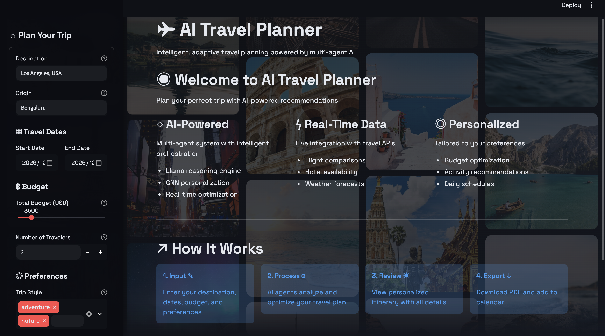
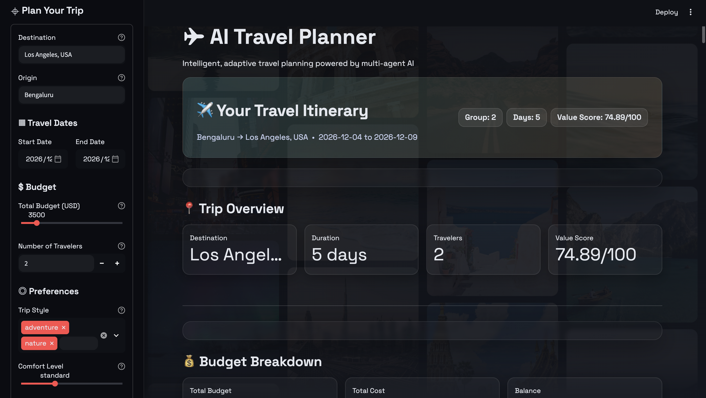
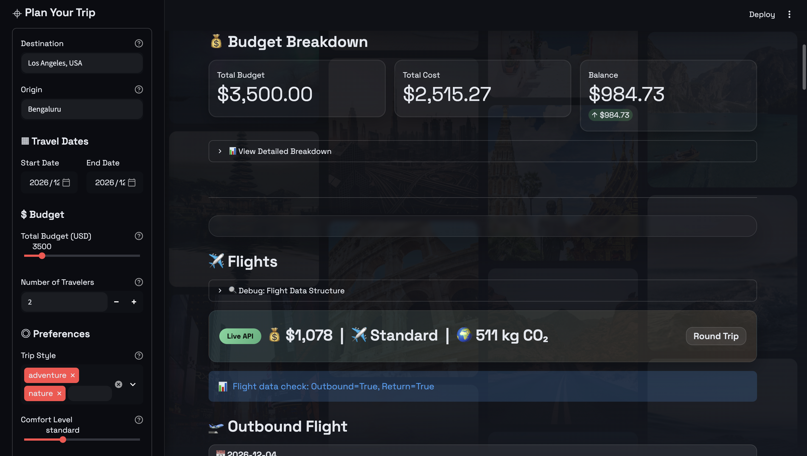

# 🌍 Smart AI Route and Itinerary Assistant (A.R.A.I)

An intelligent, adaptive travel planning system powered by multi-agent AI orchestration, real-time data integration, and personalized recommendations.







## 🧠 Overview

This system transforms fragmented travel planning into an intelligent, dynamic experience using:

- **Llama-based Orchestrator** for reasoning & planning
- **GNN Agent** for personalized recommendations
- **Real-time API Integration** for flights, hotels, and weather
- **Budget Optimizer** for cost vs. comfort tradeoffs
- **Modern Streamlit UI** with dark theme for dynamic user interaction
- **PDF Export** for downloadable itineraries
- **Calendar Export** (.ics format)


## 🏗️ Architecture

```
A.R.A.I/
├── backend/               # Core AI agents and orchestration
│   ├── orchestrator.py   # Llama model for intent parsing
│   ├── api_manager.py    # Real-time/mock API integration
│   ├── personalization_gnn.py  # GNN-based personalization
│   ├── budget_optimizer.py     # Cost optimization
│   ├── itinerary_agent.py      # Itinerary generation + PDF
│   ├── utils/            # Utilities and configuration
│   └── main.py           # Unified orchestrator entry
│
└── frontend/             # Streamlit web interface
    ├── app.py           # Main Streamlit app
    ├── components/      # UI components
    └── styles/          # Custom CSS and theming
```

## 🚀 Quick Start

### Easy Way (Recommended) 🎯

```bash
# Just run this - it does everything!
./run.sh
```

Then choose option 1 for the Web UI.

### Manual Setup

**Step 1:** Install Dependencies

```bash
pip install -r requirements.txt
```

**Step 2:** Set Up API Keys (REQUIRED for flight and hotel data)

Create a `.env` file:
```bash
# REQUIRED for flights and hotels
SERPAPI_API_KEY=your_key_here  # Get from serpapi.com (100 searches/month free)

# Optional for weather
OPENWEATHER_API_KEY=your_key_here  # Free from openweathermap.org

# Optional for activities
YELP_API_KEY=your_key_here  # Free from yelp.com/developers
```

**Step 3:** Run the Application

```bash
# Web UI (Recommended)
streamlit run frontend/app.py

# Or test backend directly
python backend/main.py
```

### 📚 Detailed Setup Guides

- **`QUICKSTART.md`** - Quick reference guide
- **`SETUP.md`** - Comprehensive setup documentation
- **`SETUP_SUMMARY.md`** - Installation summary

### 🧪 Verify Installation

```bash
# Test new features  
python tests/test_new_features.py
```

## ✨ Features

### User Input
- Destination selection with autocomplete
- Date range picker
- Budget slider with real-time updates
- Preference tags (Adventure, Luxury, Nature, etc.)
- Travel group size configuration

### Live Processing
- Real-time agent progress updates
- Multi-agent orchestration visualization
- Animated loading states with status indicators

### Results Dashboard
- ✈️ **Flight recommendations** with airline logos, real-time pricing, carbon emissions, and cabin class
- 🏨 **Hotel options** with images, ratings, reviews, and amenities
- 🌤️ **Weather forecasts** for each day of the trip
- 🗺️ **Interactive itinerary** with day-by-day activities
- 💰 **Budget breakdown** with detailed cost allocation and balance tracking
- 📊 **Value score** showing overall trip optimization
- 📥 **PDF itinerary** download with complete trip details
- 🗓️ **Calendar export** (.ics format) for easy scheduling

### Feedback System
- User satisfaction ratings
- Itinerary accuracy feedback
- Continuous improvement analytics stored in JSON format

## 🎨 Design Philosophy

- **Theme**: Modern dark theme with vibrant accent colors
- **Layout**: Responsive grid-based design with intuitive navigation
- **Animations**: Smooth transitions and loading states
- **UX**: Clean, modern, and accessible interface
- **Color Scheme**: Dark background with coral and blue accents

## 🧩 Backend Modules

### Orchestrator (`orchestrator.py`)
- Parses user intent using Llama model
- Validates constraints
- Coordinates agent workflow

### API Manager (`api_manager.py`)
- **SERP API Google Flights** - Real-time flight data with airline logos
- **SERP API Google Hotels** - Hotel data with images and ratings
- **OpenWeatherMap** - Weather forecasts
- **Budget-based filtering** - Filters results by budget constraints

### Personalization GNN (`personalization_gnn.py`)
- Graph Neural Network for user preferences
- Historical behavior analysis
- Contextual recommendations

### Budget Optimizer (`budget_optimizer.py`)
- Pareto optimization for cost vs. comfort
- Multiple itinerary options
- Value scoring algorithm

### Itinerary Agent (`itinerary_agent.py`)
- Consolidates all recommendations
- Generates PDF itineraries with detailed formatting
- Exports calendar events (.ics format)

## 📋 Requirements

- Python 3.9+
- PyTorch
- PyTorch Geometric
- Streamlit
- Transformers (Hugging Face)
- ReportLab
- Other dependencies in `requirements.txt`

## 🔧 Configuration

Edit `backend/utils/config.yaml` to customize:
- API keys and endpoints
- Model configurations
- Budget constraints
- Personalization parameters

## 📝 Testing

Sample input is provided in `backend/utils/sample_input.json` for testing the backend pipeline independently.

## 🤝 Contributing

Contributions are welcome! Please feel free to submit a Pull Request.

1. Fork the repository
2. Create your feature branch (`git checkout -b feature/AmazingFeature`)
3. Commit your changes (`git commit -m 'Add some AmazingFeature'`)
4. Push to the branch (`git push origin feature/AmazingFeature`)
5. Open a Pull Request

## 📄 License

This project is licensed under the MIT License - see the LICENSE file for details.

## 📧 Contact

**David Ajay**

- GitHub: [@David-Ajay](https://github.com/David-Ajay)

## ⭐ Star History

If you find this project useful, please consider giving it a star! ⭐

---

Made with ❤️ by David Ajay
